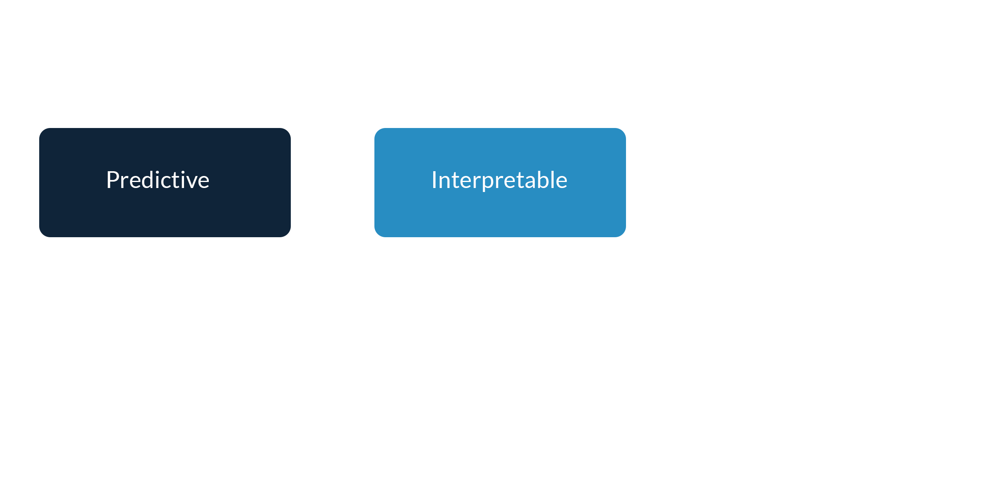
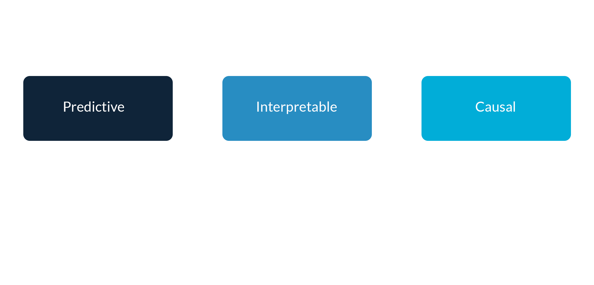
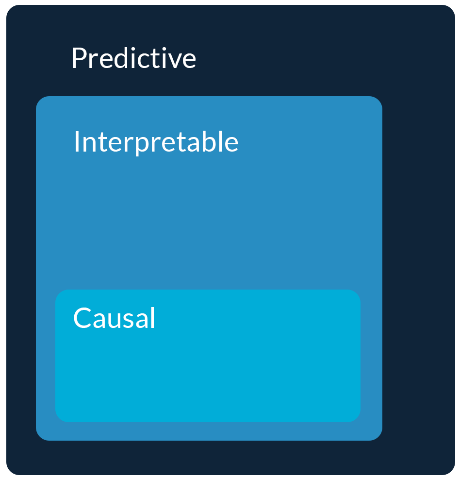
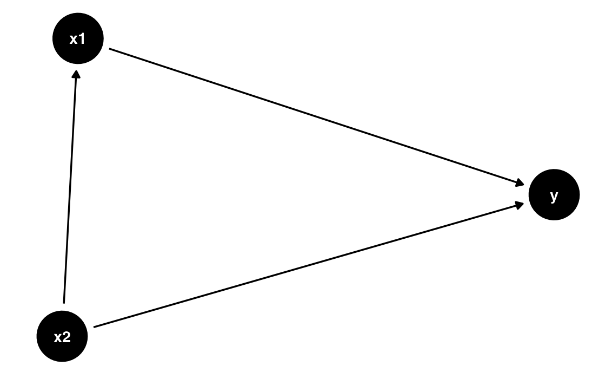
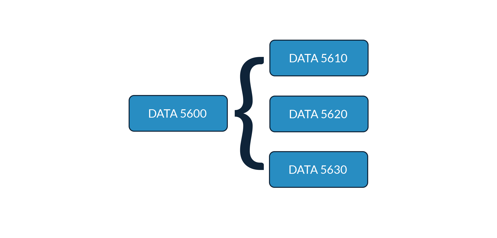

## 

::: {.v-center}
{fig-align="center"}
:::

# What does "understanding the causes of things" mean? Why would you want to? {background-color="#288DC2"}

## The mapping function is a *model*

We use models to **extract information** from data and inform decisions in the presence of uncertainty

## The mapping function is a *model* {visibility="uncounted"}

We use models to **extract information** from data and inform decisions in the presence of uncertainty

{fig-align="center"}

## The mapping function is a *model* {visibility="uncounted"}

We use models to **extract information** from data and inform decisions in the presence of uncertainty

{fig-align="center"}

## The mapping function is a *model* {visibility="uncounted"}

We use models to **extract information** from data and inform decisions in the presence of uncertainty

{fig-align="center"}

## The mapping function is a *model* {visibility="uncounted"}

We use models to **extract information** from data and inform decisions in the presence of uncertainty

{fig-align="center"}

# When would you want a causal model? When is prediction and interpretability not enough? {background-color="#288DC2"}

# Many business decisions are about *interventions*

# Many business decisions need data on *counterfactuals*

## 

{fig-align="center"}

## 

::: {.v-center}
{fig-align="center"}
:::

## Graph the relationships between $Y$ and $X$

It's helpful to draw the possible data generating process as a **graph** where

- Each node is a variable
- Each edge is an association

{fig-align="center"}

::: {.fragment}
We can use this **directed acyclic graph** (DAG) to identify causal effects and avoid omitted *and* included variable bias
:::

# What is a business decision that needs causal inference? How you would inform it? {background-color="#288DC2"}

## 

:::: {.columns .v-center}

::: {.column width="40%"}
{fig-align="center"}
:::

::: {.column width="60%"}
::: {.incremental}
- Correlation isn’t causation
- Lack of correlation isn't lack of causation
-	A causal (not "casual") model is needed for intervention and counterfactuals
-	Experimental and observational data
:::
:::

::::

## 

::: {.v-center}
{fig-align="center"}
:::

## {background-color="#288DC2"}

### DATA 5620/6620

This course focuses on the application of regression to inform decision-making, particularly using **interpretable models** to understand the **effect of interventions** on business outcomes. Students learn to model **experimental** and **observational** data and infer causality instead of correlation only. Prerequisite: DATA 5600

By the end of this course, you will be able to:

1. Specify **identification strategies** for estimating causal effects.
2. Design **effective experiments** and apply appropriate methods for experimental data.
3. **Model observational data** and infer causality using a variety of techniques.

## 

{fig-align="center"}

