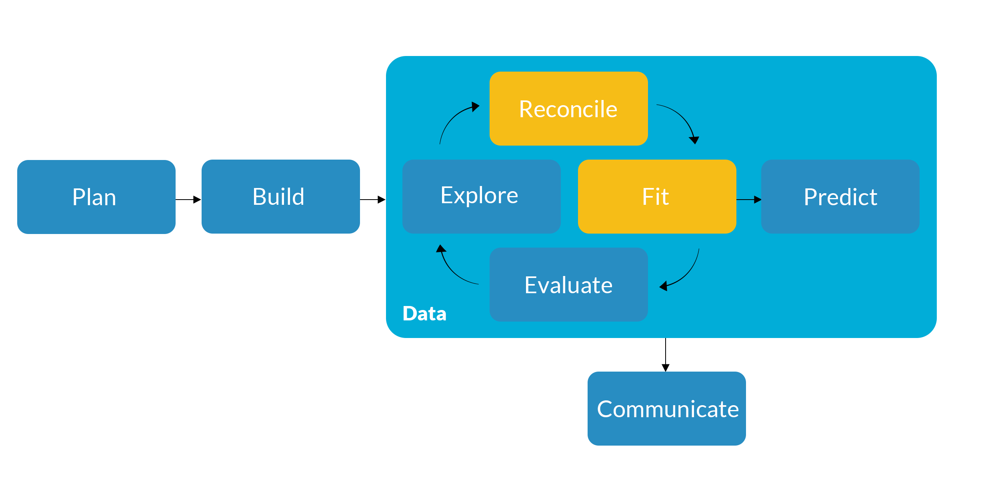
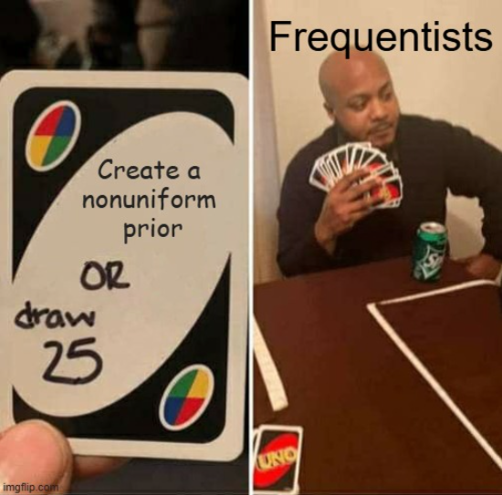
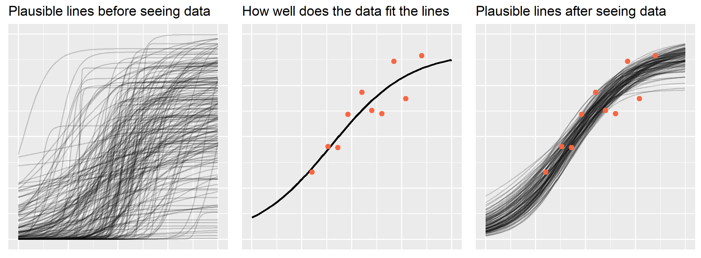

## {background-color="#288DC2"}

### Get Started {.permanent-marker-font}

#### Last Time

- Extended model fitting beyond ordinary least squares
- Continued comparing frequentist and Bayesian inference

#### Preview

- Use prior predictive checks to set priors
- Discuss using model selection to tune hyperparameters

## {background-color="#D1CBBD"}

::: {.columns .v-center}
{fig-align="center"}
:::

# Prior Predictive Checks

## Bayesian models

Both frequentist and Bayesian models use **likelihood functions**, so how does a Bayesian model differ?

:::: {.columns}

::: {.column width="60%"}
$$
y_i \sim \text{Binomial}(1, p_i) \\
\log\left({p_i \over 1 - p_i}\right) = \beta_0 + \beta_1 x_{1,i} + \cdots + \beta_p x_{p,i}
$$
:::

::: {.column width="40%"}
::: {.incremental}
- Parameters are **random variables**
- The **likelihood** $p(X, Y | \theta)$ is combined with a **prior** $p(\theta)$ to create a **posterior** $p(\theta | X, Y)$
- We sample draws from the resulting posterior distribution using **MCMC**
:::
:::

::::

## Bayesian models {visibility="uncounted"}

Both frequentist and Bayesian models use **likelihood functions**, so how does a Bayesian model differ?

:::: {.columns}

::: {.column width="60%"}
$$
y_i \sim \text{Binomial}(1, p_i) \\
\log\left({p_i \over 1 - p_i}\right) = \beta_0 + \beta_1 x_{1,i} + \cdots + \beta_p x_{p,i} \\
\beta_0 \sim \text{Normal}(0, 100) \\
\beta_1 \sim \text{Normal}(0, 100) \\
\vdots \\
\beta_p \sim \text{Normal}(0, 100)
$$
:::

::: {.column width="40%"}
- Parameters are **random variables**
- The **likelihood** $p(X, Y | \theta)$ is combined with a **prior** $p(\theta)$ to create a **posterior** $p(\theta | X, Y)$
- We sample draws from the resulting posterior distribution using **MCMC**
:::

::::

::: {.fragment .fade-up .h-center}
### How do we specify priors?
:::

## 

::: {.v-center}
{fig-align="center"}
:::

## Start with the previous exercise solution {.scrollable}

```{python}
#| eval: true

import arviz as az
import bambi as bmb
import numpy as np
import polars as pl
import statsmodels.api as sm
import statsmodels.formula.api as smf
from pyprojroot.here import here
from sklearn.model_selection import train_test_split

# Collapse industries into aggregate categories
industry_names = {
  # Business
  'Business': 'Business',
  'Retail': 'Business',
  'CPG': 'Business',
  'Luxury': 'Business',
  'eCommerce': 'Business',
  'Airlines': 'Business',

  # Tech
  'Tech': 'Tech',
  'Media': 'Tech',

  # ProfessionalServices
  'Professional Services': 'ProfessionalServices',
  'Finance': 'ProfessionalServices',
  'Marketing': 'ProfessionalServices',
  'Consulting': 'ProfessionalServices',

  # HealthcareEducation
  'Medical': 'HealthcareEducation',
  'Education': 'HealthcareEducation',

  # Public
  'Government & Non-Profits': 'Public',
  'Utilities': 'Public',
  'Construction & Manufacturing': 'Public'
}

leads_data = (pl.read_parquet(here('data/leads.parquet'))
  # Collapse Industry into a smaller number of categories
  .with_columns(
    pl.col('Industry')
    .replace(industry_names)
    .alias('Industry')
  )
  # Drop rows with 'Other' and 'Unknown' values
  .remove(
    (pl.col('Industry') == 'Other') | (pl.col('TimeZone') == 'Unknown') |
    (pl.col('Employees') == 'Unknown')
  )
  # Make the outcome binary where 'Qualified' = 1
  .with_columns(
    pl.when(pl.col('Stage') == 'Qualified').then(1)
    .when(pl.col('Stage') == 'Disqualified').then(0)
    .alias('Qualified')
  )
  # Clean up activity type variable names
  .rename({
    'ActivityTypePhone Call': 'ActivityTypePhoneCall',
    'ActivityTypeEmail Response': 'ActivityTypeEmailResponse',
    'ActivityTypeLead Handraise': 'ActivityTypeLeadHandraise',
    'ActivityTypeWeb Schedule': 'ActivityTypeWebSchedule'
  })
  # Exclude Amount
  .select(pl.exclude('Amount'))
)

# Specify the design matrix and outcome
X = leads_data.select(pl.exclude('Qualified'))
y = leads_data.select('Qualified')

# Split into training and testing sets
X_train, X_test, y_train, y_test = train_test_split(X, y, test_size = 0.2, random_state = 42, stratify = y.to_numpy())

# Overwrite X_train with feature engineering for training data
X_train = (X_train
  # Log-transform
  .with_columns(
    ((pl.col('ActivityTypeEmailResponse') + 1).log().alias('log_ActivityTypeEmailResponse')),
    ((pl.col('ActivityTypeMeeting') + 1).log().alias('log_ActivityTypeMeeting')),
    ((pl.col('ActivityTypePhoneCall') + 1).log().alias('log_ActivityTypePhoneCall')),
    ((pl.col('days_elapsed') + 1).log().alias('log_days_elapsed'))
  )
  # Dummy code discrete predictors
  .to_dummies(
    columns = ['Industry', 'Employees', 'TimeZone', 'LeadSource', 'EmployeeId'], 
    drop_first = False
  )
  # Drop Stage and raw variables along with reference levels
  .select(pl.exclude(
    'Stage', 'days_elapsed', 'ActivityTypeEmailResponse', 'ActivityTypeMeeting',
    'ActivityTypePhoneCall', 'Industry_Business', 'Employees_Small', 
    'TimeZone_EST', 'LeadSource_Purchased List', 'EmployeeId_1'
  ))
  # Clean up lead source variable names
  .rename({
    'LeadSource_Trade Shows and Events': 'LeadSource_TradeShowsandEvents',
    'LeadSource_Web Registration': 'LeadSource_WebRegistration'
  })
)

# Combine y_train and X_train
leads_train = (pl.concat([y_train, X_train], how = 'horizontal_extend')
  .to_pandas()
)
```

## Priors are part of the model {.scrollable}

A prior distribution's parameters are known as **hyperparameters** and should be set to reflect what information we have about the parameters outside the data

[What information could we have about the parameters outside the data?]{.fragment}

::: {.fragment}
```{python}
#| eval: true
#| output-location: slide

predictors_01 = [
  'Industry_HealthcareEducation', 'Industry_ProfessionalServices',
  'Industry_Public', 'Industry_Tech', 
  'Employees_Large', 'Employees_Medium',
  'TimeZone_CST', 'TimeZone_MST', 'TimeZone_PST',
  'LeadSource_TradeShowsandEvents', 'LeadSource_WebRegistration',
  'log_days_elapsed', 'created_quarter', 'contact_quarter', 
  'latest_quarter', 'EmployeeId_2', 'EmployeeId_3', 'EmployeeId_4', 
  'EmployeeId_5', 'ActivityTypeEmail', 'log_ActivityTypePhoneCall', 
  'log_ActivityTypeEmailResponse', 'log_ActivityTypeMeeting', 
  'ActivityTypeLeadHandraise', 'ActivityTypeWebSchedule'
]

ba_model = bmb.Model(
  'Qualified ~ ' + ' + '.join(predictors_01), 
  data = leads_train,
  family = 'bernoulli'
)

ba_model
```
:::

## Prior and posterior predictive distributions

{fig-align="center"}

[We previously compared the **posterior predictive distribution** (i.e., the distribution of predictions based on the whole posterior) and compared it to the real data as another model diagnostic]{.fragment}

[A **prior predictive distribution** (a.k.a., a prior predictive check) is the distribution of predictions based on the likelihood and prior specifications *alone* and can help us specify priors]{.fragment}

## Visualize the prior predictive distribution

By default the prior predictive distribution is a distribution of **predicted outcomes** (i.e., a binary outcome for our sales leads case study)

```{python}
#| eval: true
#| code-line-numbers: "|1-5|7|10|11|12"
#| output-location: slide
#| fig-align: center

# Specify priors
priors_dict = {
  'Intercept': bmb.Prior('Normal', mu = 0, sigma = 100),
  **{term: bmb.Prior('Normal', mu = 0, sigma = 100) for term in predictors_01}
}

ba_model.set_priors(priors = priors_dict)

# Prior predictive sampling
ba_model.build()
ba_ppc = ba_model.prior_predictive()
az.plot_ppc_dist(ba_ppc, group = 'prior_predictive')
```

## Visualize the prior predictive distribution

What do the predicted probabilities of lead qualification suggest?

```{python}
#| eval: true
#| output-location: column

# Visualize the predicted probabilities
az.plot_dist(
  ba_ppc, 
  group = 'prior', 
  var_names = ['p'], 
  sample_dims = ['chain', 'draw', '__obs__']
)
```

# Try specifying different priors. How does the prior predictive distribution change? {background-color="#006242"}

# Hyperparameter Tuning

## Dealing with hyperparameters

In general, **hyperparameters** are parameters that are not directly estimated when we fit the model

::: {.fragment}
What sort of "hyperparameters" have already been suggested?

::: {.incremental}
- Prior distribution hyperparameters (e.g., $\mu$ and $\sigma^2$ for normal priors)
- Deciding on what predictors to include in the model (including eventually **interactions**)
- Feature engineering decisions (e.g., whether or not to **standardize/normalize**)
- Choosing between different likelihood and link functions
:::
:::

::: {.fragment}
Predictive models often have **many** hyperparameters, so how do we set them?
:::

## Overall model fit and hyperparameter tuning

We can use **overall model fit** to compare models with different hyperparameters and choose the best one, a process known as **hyperparameter tuning**

```{python}
#| eval: false

# Specify a second set of predictors (without activity types)
predictors_02 = [
  'Industry_HealthcareEducation', 'Industry_ProfessionalServices',
  'Industry_Public', 'Industry_Tech', 
  'Employees_Large', 'Employees_Medium',
  'TimeZone_CST', 'TimeZone_MST', 'TimeZone_PST',
  'LeadSource_TradeShowsandEvents', 'LeadSource_WebRegistration',
  'log_days_elapsed', 'created_quarter', 'contact_quarter', 
  'latest_quarter', 'EmployeeId_2', 'EmployeeId_3', 'EmployeeId_4', 'EmployeeId_5'
]

# Fit two frequentist logistic regressions
fr_fit_01 = smf.glm(
  'Qualified ~ ' + ' + '.join(predictors_01), 
  data = leads_train, 
  family = sm.families.Binomial()
).fit()

fr_fit_02 = smf.glm(
  'Qualified ~ ' + ' + '.join(predictors_02), 
  data = leads_train, 
  family = sm.families.Binomial()
).fit()
```

# Compare these two models using overall model fit. Which one predicts best? {background-color="#006242"}

# Accuracy and Intuition

## Discrete outcomes and overall model fit

For classification models we don't have residuals, $R^2$, Adjusted $R^2$, F-statistic, MSE, or RMSE

[**Accuracy** is the overall percent of correct predictions]{.fragment} [and we compare it to the baseline accuracy of always predicting the majority class]{.fragment}

[We count how many times our predictions are correct (and incorrect) by class (i.e., 0 and 1) in a **confusion matrix**]{.fragment}[, which we will find is directly related to **asymmetric loss**]{.fragment}

## Model fit, hyperparameter tuning, and bias

We've reviewed and focused on strengthening understanding as we approach some of the most important topics of the semester

To prepare for what's next, consider the following

1. Do we want to rely on in-sample, predictive, or decision-theoretic fit?
2. What could go wrong with using the test data to tune hyperparameters?
3. Why were more informative priors better than uninformative priors? What does that mean for frequentist models?

## {background-color="#006242"}

### Exercise 16 {.lato-font}

1. Review the advanced materials from the course thus far
2. Identify lingering questions you have about the concepts covered
3. Use an AI tool or talk with a TA to ask your questions and reflect on the responses you receive
4. Identify at least two questions you feel have been answered and share your prompts, the responses you received, and your reflections on the responses
5. Submit both your Quarto document and your questions, responses, and reflections as a single PDF on Canvas

## {background-color="#288DC2"}

### Wrap Up {.permanent-marker-font}

#### Summary

- Used prior predictive checks to set priors
- Discussed using model selection to tune hyperparameters

#### Next Time

- Discuss additional measures of overall classification model fit
- Introduce cross-validation for model selection and hyperparameter tuning

